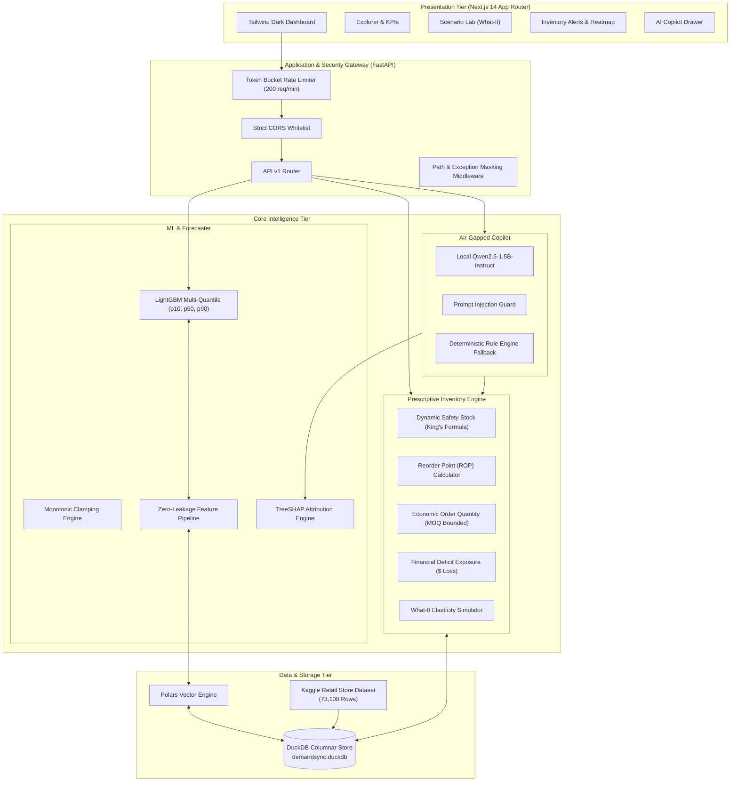
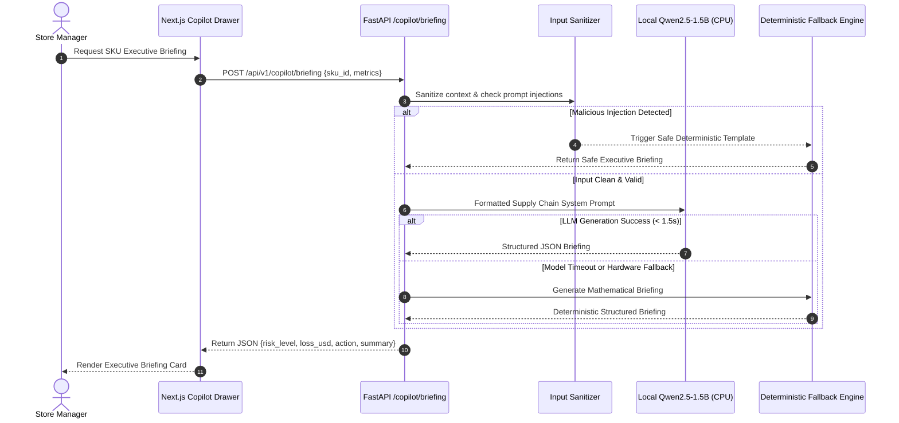

# DemandSync: Comprehensive System Architecture

## 1. Executive Summary & Core Design Philosophy

**DemandSync** is an enterprise-grade retail decision support system engineered to solve the multi-billion dollar retail dilemma: **balancing inventory holding costs against stockout revenue loss**.

Unlike conventional forecasting architectures that rely on single-point predictions ($y_t$) and upload sensitive store transactions to public cloud APIs, DemandSync is architected on four non-negotiable principles:

1. **Probabilistic by Design**: Every forecast produces full uncertainty intervals ($P_{10}, P_{50}, P_{90}$) enabling risk-adjusted operations rather than fragile single-number guesses.
2. **100% On-Device Private & Air-Gapped**: Confidential sales volume, profit margins, competitor pricing, and revenue numbers never leave the host infrastructure. The generative AI Copilot runs locally via embedded inference without external network egress.
3. **Embedded High-Throughput OLAP**: Powered by **DuckDB** and **Polars**, executing analytical queries and vector transformations in sub-milliseconds without database server administrative overhead.
4. **Prescriptive Actionability**: Machine learning distributions directly drive operational inventory policies (Safety Stock, Reorder Points, and Economic Order Quantities) with quantified financial deficit risk in USD.

---

## 2. High-Level System Architecture Diagram



---

## 3. Data Tier & Ingestion Architecture

### 3.1 Embedded Columnar Storage: DuckDB
* **Database File**: [`data/demandsync.duckdb`](file:///d:/DemandSync/data/demandsync.duckdb)
* **Concurrency Model**: Multi-threaded read access with serialized single-writer locking managed via Python `threading.RLock()`.
* **Zero-Copy Interoperability**: Queries return Arrow record batches transformed directly into Polars DataFrames using `res.to_arrow_table()` without memory duplication.

### 3.2 Relational Data Schema
```sql
-- 1. Store Dimension Table
CREATE TABLE stores (
    store_id VARCHAR PRIMARY KEY,
    store_name VARCHAR NOT NULL,
    region VARCHAR NOT NULL,
    store_type VARCHAR NOT NULL,
    square_footage INTEGER NOT NULL,
    created_at TIMESTAMP DEFAULT CURRENT_TIMESTAMP
);

-- 2. Product Dimension Table
CREATE TABLE products (
    sku_id VARCHAR PRIMARY KEY,
    sku_name VARCHAR NOT NULL,
    department VARCHAR NOT NULL,
    category VARCHAR NOT NULL,
    unit_cost DOUBLE NOT NULL,
    retail_price DOUBLE NOT NULL,
    lead_time_days DOUBLE NOT NULL,
    lead_time_std DOUBLE NOT NULL,
    min_order_qty INTEGER NOT NULL DEFAULT 1,
    holding_cost_annual_rate DOUBLE NOT NULL DEFAULT 0.20,
    order_cost DOUBLE NOT NULL DEFAULT 50.0,
    service_level DOUBLE NOT NULL DEFAULT 0.95,
    created_at TIMESTAMP DEFAULT CURRENT_TIMESTAMP
);

-- 3. Historical Sales Fact Table (All 15 Kaggle CSV Columns)
CREATE TABLE historical_sales (
    date DATE NOT NULL,
    store_id VARCHAR NOT NULL,
    sku_id VARCHAR NOT NULL,
    sales DOUBLE NOT NULL,
    price DOUBLE NOT NULL,
    discount_pct DOUBLE NOT NULL,
    promo_active INTEGER NOT NULL,
    temperature_celsius DOUBLE NOT NULL,
    precipitation_mm DOUBLE NOT NULL,
    extreme_weather_flag INTEGER NOT NULL,
    stock_on_hand INTEGER NOT NULL DEFAULT 0,
    units_ordered DOUBLE DEFAULT 0.0,
    demand_forecast DOUBLE DEFAULT 0.0,
    competitor_price DOUBLE DEFAULT 0.0,
    weather VARCHAR DEFAULT 'Sunny',
    seasonality VARCHAR DEFAULT 'Autumn',
    category VARCHAR DEFAULT 'General',
    region VARCHAR DEFAULT 'General',
    PRIMARY KEY (date, store_id, sku_id)
);

-- 4. Live Inventory Snapshots Table
CREATE TABLE inventory_snapshots (
    store_id VARCHAR NOT NULL,
    sku_id VARCHAR NOT NULL,
    current_stock INTEGER NOT NULL,
    mean_daily_demand DOUBLE NOT NULL,
    std_daily_demand DOUBLE NOT NULL,
    safety_stock INTEGER NOT NULL,
    reorder_point INTEGER NOT NULL,
    economic_order_qty INTEGER NOT NULL,
    is_breached BOOLEAN NOT NULL,
    stockout_risk_pct DOUBLE NOT NULL,
    projected_stockout_loss_usd DOUBLE NOT NULL,
    PRIMARY KEY (store_id, sku_id)
);

-- 5. Precomputed Features Matrix
CREATE TABLE precomputed_features (
    date DATE NOT NULL,
    store_id VARCHAR NOT NULL,
    sku_id VARCHAR NOT NULL,
    sales DOUBLE NOT NULL,
    price DOUBLE NOT NULL,
    discount_pct DOUBLE NOT NULL,
    promo_active INTEGER NOT NULL,
    temperature_celsius DOUBLE NOT NULL,
    precipitation_mm DOUBLE NOT NULL,
    extreme_weather_flag INTEGER NOT NULL,
    day_of_week INTEGER NOT NULL,
    day_of_month INTEGER NOT NULL,
    month INTEGER NOT NULL,
    is_weekend INTEGER NOT NULL,
    sales_lag_1 DOUBLE NOT NULL,
    sales_lag_7 DOUBLE NOT NULL,
    sales_lag_14 DOUBLE NOT NULL,
    sales_lag_28 DOUBLE NOT NULL,
    sales_roll_mean_7 DOUBLE NOT NULL,
    sales_roll_std_7 DOUBLE NOT NULL,
    sales_roll_mean_28 DOUBLE NOT NULL,
    sales_roll_min_7 DOUBLE NOT NULL,
    sales_roll_max_7 DOUBLE NOT NULL,
    PRIMARY KEY (date, store_id, sku_id)
);
```

---

## 4. Feature Engineering & Temporal Leakage Guarantees

In time series machine learning, calculating rolling statistics on unshifted target vectors introduces **temporal leakage** (using tomorrow's sales to predict tomorrow's demand). 

[`feature_pipeline.py`](file:///d:/DemandSync/backend/app/ml/feature_pipeline.py) enforces strict temporal safety:

```python
# 1. Shift target vector by 1 day per (store, SKU) group
shifted_sales = pl.col("sales").shift(1).over(["store_id", "sku_id"])

# 2. Compute rolling statistics strictly on historical observations
sales_roll_mean_7 = shifted_sales.rolling_mean(window_size=7, min_samples=1)
sales_roll_std_7  = shifted_sales.rolling_std(window_size=7, min_samples=2)
sales_roll_min_7  = shifted_sales.rolling_min(window_size=7, min_samples=1)
sales_roll_max_7  = shifted_sales.rolling_max(window_size=7, min_samples=1)
sales_roll_mean_28 = shifted_sales.rolling_mean(window_size=28, min_samples=1)

# 3. Discrete Lag Vectors
sales_lag_1  = pl.col("sales").shift(1).over(["store_id", "sku_id"])
sales_lag_7  = pl.col("sales").shift(7).over(["store_id", "sku_id"])
sales_lag_14 = pl.col("sales").shift(14).over(["store_id", "sku_id"])
sales_lag_28 = pl.col("sales").shift(28).over(["store_id", "sku_id"])
```

---

## 5. Probabilistic Forecasting Engine

### 5.1 Multi-Quantile Pinball Loss Optimization
DemandSync fits three distinct LightGBM Regressors with quantile objectives $\alpha \in \{0.10, 0.50, 0.90\}$:

$$\mathcal{L}_\alpha(y, \hat{y}) = \max\Big(\alpha(y - \hat{y}), (1 - \alpha)(\hat{y} - y)\Big)$$

* **$P_{10}$ Model ($\alpha = 0.10$)**: Penalizes over-forecasting heavily ($9\times$ penalty). Serves as a defensive operational baseline to prevent overstocking perishable goods.
* **$P_{50}$ Model ($\alpha = 0.50$)**: Minimizes Mean Absolute Error (MAE), serving as the median operational forecast.
* **$P_{90}$ Model ($\alpha = 0.90$)**: Penalizes under-forecasting heavily ($9\times$ penalty). Protects high-margin, mission-critical SKUs from stockouts during surge periods.

### 5.2 Monotonic Quantile Sorting & Clamping
Because independent models can occasionally produce crossing quantiles due to variance, [`forecaster.py`](file:///d:/DemandSync/backend/app/ml/forecaster.py) enforces monotonic ordering:

$$\hat{y}_{P10} = \max\Big(0.0, \hat{y}_{P10}\Big)$$
$$\hat{y}_{P50} = \max\Big(\hat{y}_{P10}, \hat{y}_{P50}\Big)$$
$$\hat{y}_{P90} = \max\Big(\hat{y}_{P50}, \hat{y}_{P90}\Big)$$

---

## 6. Explainable AI (XAI) & Attribution Engine

Black-box models are rejected by store managers who need to understand *why* demand will shift. 

[`explainer.py`](file:///d:/DemandSync/backend/app/ml/explainer.py) utilizes **TreeSHAP** (Tree-based SHapley Additive exPlanations) directly on the LightGBM decision tree ensemble:

$$\hat{y}(x) = \phi_0 + \sum_{j=1}^{M} \phi_j(x)$$

* $\phi_0$: Base expected value across training history.
* $\phi_j(x)$: Marginal additive contribution of feature $j$ (price discount, weekend indicator, seasonal surge, temperature shift).
* **Lift Conversion**: The engine normalizes attributions into intuitive percentages:
  $$\text{Impact Lift \%} = \frac{\phi_j}{\max(0.1, \phi_0)} \times 100\%$$

---

## 7. Prescriptive Inventory Optimization

Statistical distributions are converted directly into inventory decisions in [`inventory_engine.py`](file:///d:/DemandSync/backend/app/services/inventory_engine.py):

### 7.1 Safety Stock ($SS$) via King's Formula
Accounts for dual uncertainty in **customer demand** and **supplier lead time**:

$$SS = Z \times \sqrt{\bar{L} \cdot \sigma_D^2 + \bar{D}^2 \cdot \sigma_L^2}$$

* $Z$: Service factor ($Z = 1.645$ for 95%, $Z = 2.326$ for 99%).
* $\bar{L}, \sigma_L$: Mean and standard deviation of supplier lead time (days).
* $\bar{D}, \sigma_D$: Mean and standard deviation of daily sales demand.

### 7.2 Reorder Point ($ROP$)
$$ROP = \lceil \bar{D} \times \bar{L} + SS \rceil$$
When physical stock on hand dips below $ROP$, an automatic stockout alert is flagged.

### 7.3 Economic Order Quantity ($EOQ$)
Minimizes total annual procurement and holding costs, bounded by Supplier Minimum Order Quantity ($MOQ$):

$$EOQ = \max\left(MOQ, \left\lceil \sqrt{\frac{2 \cdot D_{\text{annual}} \cdot S}{H}} \right\rceil\right)$$

* $S$: Fixed cost per order ($USD).
* $H$: Annual holding cost per unit ($USD).

### 7.4 Financial Deficit Risk
$$\text{Deficit Units} = \max\Big(0.0, \hat{y}_{P50} - \text{Current Stock}\Big)$$
$$\text{Projected Revenue Loss} = \text{Deficit Units} \times (\text{Retail Price} - \text{Unit Wholesale Cost})$$

---

## 8. "What-If" Scenario Simulation Engine

[`scenario_service.py`](file:///d:/DemandSync/backend/app/services/scenario_service.py) simulates hypothetical business disruptions in real time:

* **Price Elasticity Shock**:
  $$\text{Demand Multiplier} = (1.0 + \text{Discount Pct})^{1.8}$$
* **Temperature Anomaly Multiplier**: Category-sensitive sensitivity curves (e.g., cold shocks boost Outerwear demand $+3.5\times$ while reducing Cold Beverages $-70\%$).
* **Supplier Congestion Shock**: Increases lead-time variance, expanding safety stock buffers and advancing reorder triggers.

---

## 9. Private On-Device AI Copilot Architecture



* **Air-Gapped Guarantee**: Tested and verified with Python socket interceptors (`block_external_sockets`) ensuring zero outbound network connections during inference.
* **Deterministic Fallback**: In the event of hardware memory exhaustion or malformed LLM responses, the system gracefully falls back to a mathematical deterministic rule engine.

---

## 10. Security & Production Hardening Matrix

| Security Layer | Implementation Mechanism | Threat Mitigated |
| :--- | :--- | :--- |
| **Network Isolation** | `socket.socket.connect` validation | External proprietary data leakage (Data Egress) |
| **API Rate Limiting** | In-Memory Token Bucket (`200 req/min`, `burst 200`) | Denial of Service (DoS) and API abuse |
| **CORS Policy** | Whitelist (`localhost:3000`, `127.0.0.1:3000`) | Cross-Origin Request Forgery & unauthorized browser reflection |
| **SQL Injection Guard** | DuckDB `frozenset` table whitelist + parameterization | SQL injection and unauthorized table drops |
| **Exception Masking** | Global HTTP 500 handler redacting file paths and lines | Server information leakage & internal path exposure |
| **Input Validation** | Pydantic v2 strict schemas with `extra="forbid"` | Parameter smuggling & malformed JSON attacks |
| **Type Integrity** | TypeScript 5.9 strict typechecking (`npx tsc --noEmit`) | Runtime UI crashes & implicit `any` bugs |

---

## 11. Technology Stack Summary

* **Backend Framework**: Python 3.13, FastAPI 0.115, Pydantic v2.
* **Database & OLAP**: DuckDB 2.0 (Embedded Columnar), Polars 2.0 (Vectorized DataFrame engine), PyArrow 15.0+.
* **Machine Learning & XAI**: LightGBM 4.7, Scikit-Learn 1.6, SHAP 0.54.
* **Local Language Model**: Qwen/Qwen2.5-1.5B-Instruct, HuggingFace Transformers, PyTorch CPU.
* **Frontend Application**: Next.js 14.2 (App Router), React 18.3, TailwindCSS 3.4, Lucide-React.
* **Packaging & Package Management**: `uv` (Python), `pnpm` (Node.js).
