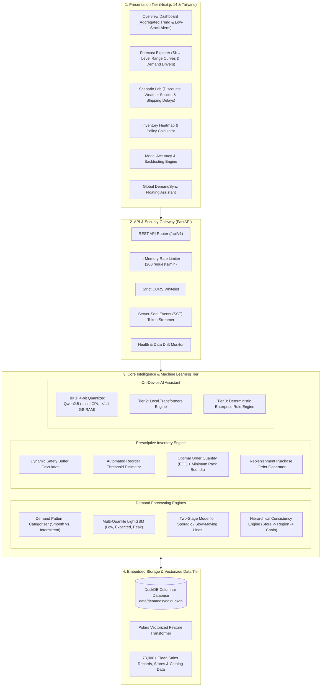

# DemandSync: Architecture & Engineering Blueprint

## 1. Executive Overview: What Problem Does DemandSync Solve?

In the retail, wholesale, and e-commerce industries, companies face a constant multi-million-dollar dilemma:

1. **Holding Too Much Inventory (Overstocking)**: Excess stock ties up working capital in warehouses, increases carrying costs (storage, insurance, spoilage, depreciation), and forces heavy markdowns that erode margins.
2. **Holding Too Little Inventory (Stockouts)**: If customer demand surges and shelves are empty, the business loses immediate revenue and customers switch to competitors.

Most legacy enterprise systems try to forecast demand using a **single static number** (e.g., *"Store 1 will sell exactly 50 units next Tuesday"*). Real life never works that way. Weather disruptions, promotional discounts, supplier shipping delays, and day-of-week trends constantly shift customer purchasing patterns.

Furthermore, traditional AI tools often send sensitive sales data, store revenues, and vendor margins to third-party cloud APIs, introducing severe data privacy and regulatory risks.

### What DemandSync Does
**DemandSync** is an all-in-one, privacy-first **Retail Decision & Demand Forecasting Platform**. It replaces guesswork with **probabilistic risk intelligence** and translates forecasts directly into automated inventory purchase orders. 

DemandSync operates on four fundamental engineering rules:
- **Range-Based Forecasting**: Instead of guessing one number, DemandSync predicts an **Expected Baseline**, a **Low Estimate**, and a **Peak Surge Potential**. Inventory managers make decisions tailored to their risk tolerance.
- **100% Private & On-Device**: Confidential revenues, margins, and sales records never leave your local infrastructure. The embedded AI assistant runs directly on local CPU hardware with zero external cloud egress.
- **Sub-Millisecond Speed**: Powered by **DuckDB** and **Polars**, complex historical analytics across hundreds of thousands of sales rows run in milliseconds without heavy database server maintenance.
- **Actionable Execution**: Demand predictions do not simply sit in charts. The system computes exact replenishment amounts and generates standard purchase orders ready for enterprise ERP systems (SAP, Oracle, NetSuite).

---

## 2. High-Level Architecture Diagram

The system is organized into four clean, loosely coupled layers: **Presentation (Frontend)**, **API & Security Gateway**, **Core Intelligence & Machine Learning**, and **Embedded High-Speed Storage**.



---

## 3. The Core System Pillars Explained

### Pillar 1: Smart Demand Forecasting (Predicting the Range)
When forecasting sales for a store, DemandSync produces three figures for every item every day:
1. **Low Estimate (P10)**: The defensive lower bound. There is a 90% probability sales will exceed this number. This is crucial for avoiding overstocking perishable or high-cost inventory.
2. **Expected Sales (P50)**: The median, most likely scenario. This forms the baseline for regular store replenishment.
3. **Peak Surge Potential (P90)**: The surge upper bound. Only 10% of days exceed this volume. This helps store managers prepare for weekend rushes, promotional events, or seasonal weather spikes.

To ensure consistency, DemandSync uses **Hierarchical Reconciliation**. This ensures that forecasts at the individual item level sum up cleanly to the store total, regional total, and chain-wide corporate revenue forecast without mathematical discrepancies.

---

### Pillar 2: Cash-Flow & Inventory Optimization
Forecasting is only useful if it tells managers what to do. DemandSync includes a prescriptive inventory engine that automates replenishment math:

- **Safety Reserve (Buffer Stock)**: The extra cushion required to absorb unexpected customer surges or supplier delivery delays. Instead of guessing a flat percentage, DemandSync calculates this dynamically using lead-time variation and sales standard deviation.
- **Minimum Stock Level (Reorder Point)**: The exact threshold where new inventory must be ordered. When current stock on hand drops below this number, the system triggers an alert.
- **Recommended Order Size**: Computes the most cost-effective order size by balancing shipping/ordering costs against annual inventory holding costs, bounded by supplier Minimum Order Quantities (MOQ).
- **1-Click Purchase Orders**: Generates complete purchase orders with vendor details, unit costs, payment terms (Net 30), and lead times, ready for CSV export or ERP integration (EDI 850 / SAP MM).

---

### Pillar 3: What-If Scenario Lab
In retail, operations teams constantly ask questions like:
- *"What happens if we discount this winter jacket by 20% during a cold snap?"*
- *"What happens to our inventory if our overseas supplier is delayed by 7 days due to port congestion?"*

The **Scenario Lab** allows operators to interactively tweak sliders for price discounts, temperature anomalies, extreme weather flags, and supplier delays. The system recalculates 30-day demand curves in real time, projecting whether the store will run out of stock and how much gross margin is at risk.

---

### Pillar 4: Model Accuracy & Continuous Evaluation
Unlike black-box models, DemandSync provides complete transparency:

- **Chronological Backtesting**: The system evaluates its predictions using out-of-sample historical testing. It trains models on earlier data and validates against subsequent real-world sales records with zero data leakage.
- **Forecast Reliability Metrics**: Tracks volume-weighted error rates (WAPE) and directional bias (checking whether the model systematically over-forecasts or under-forecasts) so merchandising teams know when to trust the numbers.
- **Data Drift Monitoring**: Runs continuous statistical tests on incoming sales patterns to verify that customer demand characteristics remain stable and alerts operators if shopping habits shift unexpectedly.

---

### Pillar 5: On-Device DemandSync Assistant
DemandSync features an AI assistant built right into the interface as an accessible floating widget:

- **Full local AI model**: Runs 100% locally on your computer's CPU using a high-efficiency 4-bit quantized model (`Qwen2.5-1.5B`). It requires no GPU, uses less than 1.1 GB of RAM, and never connects to third-party cloud APIs.
- **Three-Tier Fault Tolerance**:
  - **Tier 1 (Local Quantized LLM)**: Fast, intelligent natural language synthesis streamed via Server-Sent Events (SSE).
  - **Tier 2 (Local PyTorch Engine)**: Fallback engine if native quantization binaries are unavailable.
  - **Tier 3 (Enterprise Rule Engine)**: Deterministic business logic that guarantees accurate inventory briefings and reorder numbers.
- **Plain Business Language**: Answers queries in crisp, professional business statements with clear emojis, tables, and action directives.

---

### Pillar 6: High-Performance Local Data Storage
Traditional enterprise analytics platforms require separate database clusters, connection pools, and dedicated database administrators. DemandSync avoids this overhead completely:

- **DuckDB**: An embedded, columnar analytical database (similar to SQLite, but optimized for multi-million-row analytical queries). It runs directly inside the backend process, executing complex aggregation queries in under 5 milliseconds.
- **Polars**: A vector-accelerated DataFrame engine written in Rust that builds rolling averages, seasonal day-of-week lags, and trend features at maximum CPU efficiency.

---

## 4. Frontend Architecture & Enterprise Design

The presentation tier is built with **Next.js 14 (App Router)** and **Tailwind CSS**, designed to look and feel like real enterprise platforms.
- **Persistent Floating Chatbot**: The DemandSync Assistant is mounted as a global floating button in the bottom-right corner of the screen. Users can access instant inventory insights from any page or pass specific SKUs and stores into the chat with one click.

---

## 5. Technology Stack Summary

| Layer | Technology | Primary Purpose |
| :--- | :--- | :--- |
| **Frontend Framework** | Next.js 14 (React 18, TypeScript) | Server and client component rendering with fast App Router navigation. |
| **Styling & Icons** | Tailwind CSS, Lucide React | Clean, responsive enterprise dark/light theme styling and iconography. |
| **Backend Framework** | FastAPI (Python 3.11+ / 3.13) | Asynchronous, high-performance REST API with SSE streaming support. |
| **Analytical Database** | DuckDB | Embedded columnar OLAP store providing sub-5ms analytical query speeds. |
| **Feature Engineering** | Polars & NumPy | Vectorized time-series lag creation, rolling windows, and data transformation. |
| **Machine Learning** | LightGBM, Scikit-Learn | Multi-quantile gradient boosting for $P_{10}, P_{50}, P_{90}$ demand prediction. |
| **On-Device AI Engine** | llama-cpp-python (Qwen2.5-1.5B 4-bit) | Local quantized large language model running on CPU. |
| **Testing & Quality** | Pytest, TypeScript Compiler (`tsc`) | Automated unit tests, zero-egress validation, and end-to-end type safety. |

---

## 6. Guide to Run DemandSync Locally

Follow these step-by-step instructions to run both the backend and frontend locally on your machine.

### Prerequisites
Before starting, ensure you have the following installed on your computer:
1. **Python 3.13**
2. **Node.js (v18.0 or higher)**
3. **Git**

---

### Step 1: Clone the Repository & Open the Project
Open your terminal (PowerShell, Command Prompt, or Terminal) and navigate to the project directory:
```bash
git clone https://github.com/vkshdev/DemandSync.git
cd DemandSync
```

---

### Step 2: Set Up the Python Backend Virtual Environment

1. Create a dedicated virtual environment:
   ```powershell
   python -m venv .venv
   ```

2. Activate the virtual environment:
   - **Windows (PowerShell)**:
     ```powershell
     .\.venv\Scripts\Activate.ps1
     ```
   - **Windows (Command Prompt)**:
     ```cmd
     .\.venv\Scripts\activate.bat
     ```
   - **macOS / Linux**:
     ```bash
     source .venv/bin/activate
     ```

3. Upgrade `pip` and install all backend requirements:
   ```bash
   python -m pip install --upgrade pip
   pip install -r requirements.txt
   ```

---

### Step 3: Initialize the Database & Models

DemandSync comes with automated setup scripts that generate realistic multi-store sales data, compute time-series features, and train the baseline quantile models:

1. Generate the initial dataset and seed DuckDB:
   ```bash
   python backend/app/data/generate_dataset.py
   ```

2. (Optional) Download the local 4-bit quantized AI assistant model:
   ```bash
   python backend/app/services/download_model.py
   ```
   *(Note: If you skip this, the assistant will automatically use its built-in Tier 3 enterprise rule engine without any loss of core functionality).*

---

### Step 4: Start the FastAPI Backend Server

With your virtual environment active and your terminal in the root `DemandSync` directory, run:
```powershell
$env:PYTHONPATH="backend"
python -m uvicorn app.main:app --host 0.0.0.0 --port 8000 --reload
```
*(On macOS/Linux: `PYTHONPATH=backend python -m uvicorn app.main:app --host 0.0.0.0 --port 8000 --reload`)*

Once started, verify that the backend is running:
- **API Health Check**: Open `http://localhost:8000/api/v1/health` in your browser (should return `{"status":"ok"}`).
- **Interactive Swagger Docs**: Open `http://localhost:8000/docs` to test all endpoints.

---

### Step 5: Start the Next.js Frontend Server

Open a **second terminal window**, navigate to the `frontend` folder, and start the development server:

1. Navigate to the frontend directory:
   ```bash
   cd DemandSync/frontend
   ```

2. Install dependencies (only needed the first time):
   ```bash
   npm install
   ```

3. Start the Next.js development server:
   ```bash
   npm run dev
   ```

---

### Step 6: Open the Application

Open your browser and navigate to:
```
http://localhost:3000
```
---
